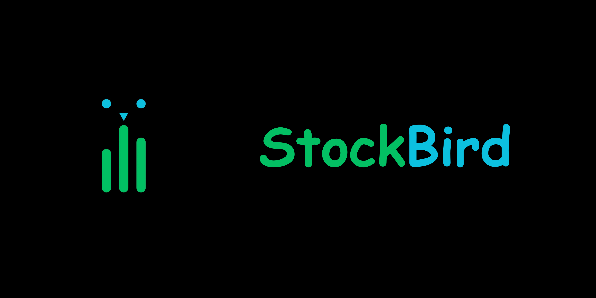

<p align="center">
  
</p>

<p align="center">
  <b>Stock analysis, screening, portfolios and alerts in one app.</b><br>
  AI-powered market analysis, stock screening, charts, portfolios and alerts.
</p>

<p align="center">
  <a href="#quick-start"><b>Quick start</b></a> ·
  <a href="#features"><b>Features</b></a> ·
  <a href="#run-it-from-the-source-code"><b>Run from source</b></a>
</p>

> StockBird is an analysis tool, not investment advice.

## Features

<table>
  <tr>
    <td width="45%" valign="top">
      <h3>🤖 AI analysis</h3>
      A set of AI analysts helps explain stocks in plain language, with technical, risk and news insights. Connect your own AI provider or use a local Ollama installation.
    </td>
    <td width="55%"></td>
  </tr>
  <tr>
    <td width="55%"></td>
    <td width="45%" valign="top">
      <h3>🔎 Stock screeners</h3>
      Explore markets with ready-made and custom screens, helping you discover and compare potential opportunities.
    </td>
  </tr>
  <tr>
    <td width="45%" valign="top">
      <h3>🧭 Market insights</h3>
      Explore sector rotation, trending stocks, market activity, world markets and other useful market information in one place.
    </td>
    <td width="55%"></td>
  </tr>
  <tr>
    <td width="55%"></td>
    <td width="45%" valign="top">
      <h3>💬 Bot and console</h3>
      Access tools and information through the built-in console and supported messaging integrations.
    </td>
  </tr>
</table>

| | |
| --- | --- |
| 📈 **Charts and trading tools** | Candlestick charts, indicators, scanners, backtesting, options analysis, pairs trading, position sizing and trading journals |
| 💼 **Portfolios and funds** | Track holdings and returns, analyse fund overlap and plan investments |
| 🔔 **Alerts and scheduled reports** | Receive notifications and scheduled reports through supported channels |
| 🔀 **Trader and Investor areas** | Switch between tools designed for short-term trading and long-term investing |
| 🌍 **Multiple languages** | Use the app in supported languages with light and dark themes |
| 🔒 **Private by default** | Your data stays under your control |

<details>
<summary><b>More screenshots</b></summary>

<br>

| Compare stocks side by side | Scheduled reports |
| --- | --- |
|  |  |

</details>

## Quick start

StockBird is built from an open-source codebase and can be run locally.

The current source still uses the original internal package name, so installation commands remain unchanged until the backend is fully renamed.

With Python 3.11 or newer on Linux, macOS or Windows:

```bash
pipx install marketmyna
marketmyna
```

The app opens in your browser at:

```text
http://127.0.0.1:8001
```

You can configure AI providers and other settings inside the application.

## Run it from the source code

Running from source is recommended if you want to customise StockBird.

### 1. Get the code and install dependencies

Linux and macOS:

```bash
git clone YOUR-STOCKBIRD-REPOSITORY-URL stockbird
cd stockbird
python3 -m venv venv
. venv/bin/activate
pip install -r requirements-web.txt
```

Windows PowerShell:

```powershell
git clone YOUR-STOCKBIRD-REPOSITORY-URL stockbird
cd stockbird
py -m venv venv
venv\Scripts\Activate.ps1
pip install -r requirements-web.txt
```

If PowerShell refuses to run the activation script, you can run:

```powershell
Set-ExecutionPolicy -Scope CurrentUser RemoteSigned
```

Alternatively, use Command Prompt with:

```text
venv\Scripts\activate.bat
```

### 2. Start StockBird

```bash
python start.py
```

The first start builds the frontend. Once running, open:

```text
http://127.0.0.1:8001
```

## Development

Run the API and frontend development server separately:

```bash
python -m uvicorn marketmyna.api.app:app --port 8001 --reload
```

Then, in another terminal:

```bash
cd frontend
npm install
npm run dev
```

The frontend development server provides live updates while you work.

## Project layout

| Folder | What's in it |
| --- | --- |
| `start.py` | Starts the application and builds the frontend when needed |
| `marketmyna/` | Current Python backend package containing data, analysis, AI tools, alerts and storage |
| `marketmyna/api/` | FastAPI application and routes |
| `marketmyna/strategies/` | AI strategy playbooks |
| `frontend/` | StockBird's React, Vite and Tailwind interface |
| `tests/` | Project tests |

> **Note:** The backend folder is still named `marketmyna` internally. This can be renamed later as part of a careful backend rebrand.

## Built with

- FastAPI
- React
- TypeScript
- Vite
- Tailwind CSS
- SQLite
- LiteLLM
- Python
- Node.js

## License and attribution

StockBird is based on the open-source MarketMyna project and is distributed under the **Apache License 2.0**.

The original copyright notices, license and `NOTICE` file must be retained when redistributing this project or derivatives of it.

The StockBird name and visual branding are separate from the original MarketMyna branding.

See the repository's `LICENSE` and `NOTICE` files for the full license and attribution information.

## Not investment advice

StockBird is an analysis tool. Nothing shown by the application is investment advice. Always do your own research and make financial decisions responsibly.
